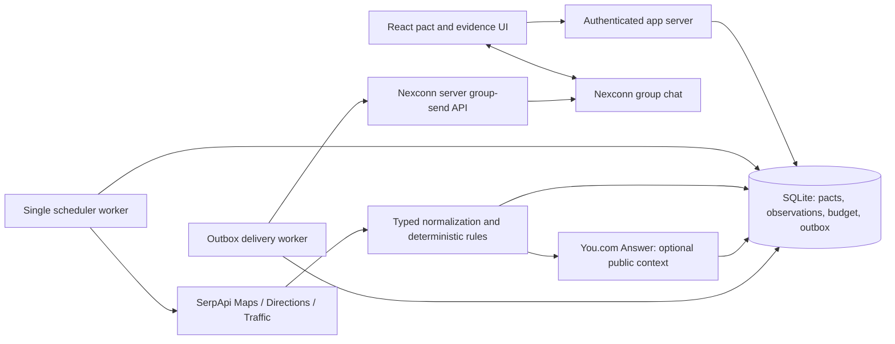

# Tripwire: Office Pact — conditional eight-hour build plan

**Status:** highest-ranked prototype candidate, **8.83/10**, below the user's 9+ selection gate. No idea currently qualifies. This plan makes the strongest candidate executable without presenting it as validated. Read `RESEARCH.md` for sources, alternatives and limitations; `astra.md` is the complete IDE handoff.

## The product promise

“Agree on when to reconsider the office trip, then check together before anyone leaves.”

Example, explicitly illustrative: Maya starts near Indiranagar; Arjun near HSR Layout. They plan to meet at a selected Bellandur workplace. They agree to reconsider if either person's fastest returned driving estimate exceeds 60 minutes on two fresh checks, before 09:00 IST. A newly observed incident in the selected area can request an additional route check. It cannot, by itself, assert that either route is blocked. The fallback is a human-approved remote meeting; the app does not book anything or change calendars.

Success for the prototype: create and approve a pact; collect typed observations from three distinct SerpApi engines; detect a comparable threshold breach without an LLM; show exactly why; deliver an alert with separately labelled You.com context to a real Nexconn group; acknowledge a decision from a second browser session.

## Scope that fits

- One team, one persistent group, two participants, one destination, one driving mode, one fixed traffic bbox, one decision deadline.
- Structured pact form embedded alongside chat. Chat can introduce the workflow; arbitrary natural-language compilation is deferred. A supported `/pact` command may open the form, but must not silently create a rule.
- One rule: maximum returned driving duration, two distinct fresh observations, five-minute freshness ceiling, five-minute recovery margin.
- One incident change type: newly observed `(incident_id, type)` in a fixed bbox; group nearby markers for display, retain original IDs in evidence. No cleared-road claim from disappearance.
- One alert receipt with source timestamps, before/after values, participant, exact condition, a contextual answer with citations, and acknowledgement actions.
- Exclude mobile push setup, payments, calendar write access, voice, multiple transit modes, route geometries, geofencing, autonomous agents, generalized rule DSL, subscriptions and enterprise auth onboarding.

## Architecture

Use a single TypeScript web application (React UI and server routes) plus a persistent server-side worker and SQLite on one long-running host. Keep the first demo on a local laptop if deployment would threaten delivery. Do not deploy a SQLite database to an ephemeral/serverless filesystem. If hosting requires serverless, use a durable SQL database and an external scheduler; that is a scope increase.



Keys and signing stay on the server. The browser gets its own scoped Nexconn token after session verification. Use pre-provisioned test identities with separate signed app sessions for the demo; do not expose an unauthenticated `userId → token` endpoint. Persist membership and check it on pact, evidence and acknowledgement endpoints. Public source content is untrusted text, never instructions to execute tools.

Sponsor separation: SerpApi supplies observable facts; deterministic application code decides whether a condition changed; You.com adds cited public context; Nexconn transports team discussion and alerts. None is a decorative logo integration.

Contracts: [Maps](https://serpapi.com/google-maps-api), [Directions](https://serpapi.com/google-maps-directions-api), [Traffic](https://serpapi.com/google-maps-traffic-api), [You Answer](https://you.com/docs/api-reference/answer/v1-answer), [Nexconn token](https://docs.nexconn.ai/platform-chat-api/user/register), [Nexconn group send](https://docs.nexconn.ai/platform-chat-api/message/send-group).

## Application data model

All fields in this section are **our application schema**, not asserted provider response fields. Store UTC instants, display Asia/Kolkata. Validate IANA timezone and derive deadlines from explicit local dates, never an ambiguous “tomorrow.”

| Entity | Minimum fields and constraints |
|---|---|
| Team / Membership | `team_id`, `user_id`, `role`, `nex_user_id`, `nex_group_id`; membership enforced server-side |
| Pact | `id`, `team_id`, `version`, `status`, `destination_place_id`, `destination_lat/lon`, `decision_deadline_utc`, `fallback_text`, `created_by`; immutable version once armed |
| Participant | `pact_id`, `user_id`, coarse `origin_lat/lon`, `max_duration_s`, `approval_version`; all approvals must match current pact version |
| Watch | `id`, `pact_id`, `engine`, canonical nonsecret `params_json`, `query_hash`, `next_due_at`, `ttl_s`, `priority`, `enabled` |
| Observation | `id`, `watch_id`, `provider_search_id`, `provider_created_at`, `received_at`, `query_hash`, `raw_hash`, `normalized_json`, `validity`, `provenance`; unique watch/provider ID; provenance live/replay/synthetic |
| RuleState | `watch_id`, `pact_version`, `last_source_at`, `consecutive_breaches`, `active`, `episode_id`; updates transactionally with observation |
| Alert | `id`, `pact_id`, `rule_version`, `episode_id`, `before_observation_id`, `after_observation_id`, `decision_status`; unique pact/rule/episode |
| CitationContext | `alert_id`, `status`, `answer`, `citations_json`, `retrieved_at`; optional, never changes rule result |
| CreditAttempt | `id`, `watch_id`, `phase`, `reserved_at`, `state`, `provider_search_id`; reserve transaction before network |
| Outbox | `alert_id`, `status`, `attempts`, `next_attempt_at`, provider receipt if documented; unique logical alert |
| Acknowledgement | `alert_id`, `user_id`, `decision`, `created_at`; unique alert/user; app state, not assumed Nexconn read receipt |

Do not store raw precise origins in team-visible messages. Display neighbourhoods. Keep raw response fixtures local/private; strip credentials from logs and exports. Delete demo location data after the event.

## Deterministic rules and scheduler

Canonical query key includes engine, selected endpoints, mode, locale, bbox/zoom or other query controls; excludes API key and fetch-control flags. A changed query or pact version establishes a new baseline. Do not compare timestamps/IDs as content changes.

1. Validate successful response and field types. Unknown or malformed data has no numerical default. Check Directions numeric units against formatted values during first live validation.
2. For each participant, choose minimum positive finite `duration` among Driving alternatives. Do not use `directions[0]` as a stable route. This tracks fastest-returned estimate, not an identified road path.
3. Require two distinct provider observations, strictly advancing source timestamps, each no older than five minutes, exceeding the participant's threshold. A cached response replay is not a second confirmation. Missing/stale data clears an unfinished confirmation streak but does not falsely recover an active alert.
4. Create one alert per breach episode; active episodes do not repeatedly notify. Recover only at or below threshold minus 300 seconds. A later new breach needs a new episode ID. Persist evidence and outbox in the same transaction.
5. New Traffic IDs generate “newly observed area incident” context and can advance the next route check, subject to a minimum interval and remaining budget. They are not a numerical rule breach. Empty incidents is “none returned,” not “no disruptions.”
6. Stop at the decision deadline, pause, or exhausted budget. Do not continue checking an expired decision. Show “Monitoring ended” and the last successful observation age.

Scheduler: one worker with a DB lease; earliest due watch first, then closest deadline. For the demo, routes every five minutes and traffic every fifteen minutes within a two-hour decision window. Reserve one unit per search attempt inside `BEGIN IMMEDIATE`, then dispatch; failed/timeout attempts remain conservatively spent. Use no automatic retries in research. Build runtime may retry transient failures only with a new reservation, capped retries and jitter. A 429 respects the documented account throughput and the next allowed retry time.

The local proof kernel tests comparability, duplicate suppression, stale/unknown handling, hysteresis, order-independent normalization and the 40-attempt research ceiling. It is not a full durable scheduler or delivery implementation.

## Credit budget

All values below are **planning ceilings**, not credits already spent. Never promise cache discounts; budget a full unit for each attempted standard search. All research work across tools must remain ≤40. The included probe currently spent zero and would attempt exactly three SerpApi searches per credentialed run.

| Pool | Calculation | SerpApi ceiling |
|---|---|---:|
| Research probes and manual coverage investigation | 3 first probes + up to 37 explicitly ledgered follow-ups | 40 |
| Implementation integration/debug | Fixed pool; no polling on React renders | 50 |
| Two-hour rehearsal | 2 route watches × 24 checks = 48; traffic × 8 = 8; setup Maps × 4 = 4 | 60 |
| Final two-hour demo window | Same capped workload | 60 |
| On-stage refresh | 3 engines × 2 controlled runs | 6 |
| Controlled error recovery | Shared contingency ceiling, not automatic permission to loop | 24 |
| **Maximum allocated spending** | Sum of pools | **240** |
| **Untouched reserve** | 500 − 240 | **260** |

Stop normal work at 216 attempted credits; the final 24 allocated units require deliberate use of the recovery pool. The 260 reserve stays untouched in this plan. Reconcile actual remaining credits and hourly throughput with the free Account API when a key exists. If the account already has other usage, reduce these ceilings accordingly. [Account API](https://serpapi.com/account-api)

You.com: cap at 12 Answer attempts (probe + distinct alert context + rehearsals); obtain actual pricing/balance from the account before running. Nexconn: target two test users, one group, low-volume messages; do not assume MAU promotional eligibility or rate limits from marketing copy. Neither consumes SerpApi credits.

## Cache, failure and delivery plan

- Maps selection cache: 24 hours, keyed by locale/query; refresh only on user request. No periodic “open seats” inference.
- Directions application cache: five minutes. Traffic: fifteen minutes. When due, explicitly use `no_cache=true` to avoid a one-hour provider cache hiding changes. Deduplicate simultaneous identical work. Record provider timestamp and receipt time separately. [SerpApi caching](https://serpapi.com/google-maps-traffic-api)
- You context: cache per normalized public query for one hour; fetch at most once per alert. Validate citation URLs and preserve source association. Do not treat an uncorroborated explanation as a cause.
- If You times out, deliver the deterministic alert promptly with “Public context unavailable.” Add context later only if supported safely. Never invent citations. This is a degraded demo and does not demonstrate full sponsor integration.
- If Nexconn is down, keep the alert in the outbox and display “Delivery pending.” Do not show Sent based on optimistic UI. Delivery timeout can be ambiguous: reconcile against documented message history/receipt before retry; without provider idempotency, exactly-once network delivery cannot be guaranteed. UI deduplicates by application alert ID.
- If SerpApi data is missing, retain previous observation as stale, mark monitoring degraded and do not assert safe travel. An explicit replay toggle may load saved live fixtures, with a persistent REPLAY badge and original timestamps.
- A deterministic stage change is allowed only with a persistent **SIMULATED CHANGE** label. Never claim a road closure just occurred. Keep synthetic data separate from raw provider fixtures.

## Eight-hour timeline and kill criteria

These are elapsed build hours, not guaranteed event wall-clock slots. If the actual coding window is 5.5 hours, prioritize hours 0–4 and reserve the last 90 minutes for testing, packaging and rehearsal; cut the additional polish and route-selection niceties.

| Elapsed | Deliverable | Acceptance / cut rule |
|---|---|---|
| 0–1 | Credentials, probes, scaffold, evidence contract | Obtain one useful place and route; confirm Traffic response semantics; v4 token and Answer checks. If route data fails, do not promise live route monitoring. |
| 1–2 | Pact model, two test sessions, approval form, venue selection | Two participants approve same immutable version; changed thresholds invalidate approval. |
| 2–3 | Nexconn group integration and simple text exchange | Both sessions observe a real message. If this fails, label Nexconn track incomplete; do not substitute a fake chat silently. |
| 3–4 | Typed adapters, normalization, detector and persisted observations | Passing stale/missing/replay/reorder tests; show one real observation and one labelled synthetic breach. |
| 4–5 | Scheduler, transaction budget, lease, outbox | No overspend under concurrent ticks; restart retains deadline and budget; one alert per episode. |
| 5–6 | You.com context and alert receipt | Actual citations open to returned sources; numerical detector unaffected by generated text. |
| 6–7 | Layout/accessibility pass, mobile states, replay fallback | Keyboard flow, 390px/1440px screenshots, no overflow, readable errors, visible provenance. |
| 7–8 | Freeze, tests, two-browser rehearsal, submission package | Three-minute demo runs twice; screen recording and README; no new features. |

## Three-minute demo

**0:00–0:25 — The cost of deciding too late.** “Our team planned Bellandur, but the useful decision is whether to leave at all. Office Pact records when we should reconsider.” Show two neighbourhoods and the agreed 60-minute limit; use illustrative names and label sample setup.

**0:25–0:55 — Make the pact.** Open the structured form from chat. Select a real Maps venue and deadline. In browser two, approve the same pact version. Point to the remote fallback and next check.

**0:55–1:25 — Prove the data.** Run one bounded fresh check. Open evidence: engine, source age, numerical estimate and original record. Traffic panel says “area incidents,” never “your route is blocked.” Show the credit counter decrement from the real ledger.

**1:25–2:00 — Demonstrate change safely.** Switch to the visibly labelled simulation. Replay two distinct fresh synthetic observations above threshold; an alert appears once. Replay the same observation: no second notification. Explain that this demonstrates the rule without waiting for real traffic to change.

**2:00–2:35 — Decide together.** Show the alert arriving in Nexconn, exact condition and before/after values. Expand the separate You.com paragraph and open a returned citation. Participant two selects “Switch to remote”; the application's acknowledgement record changes.

**2:35–3:00 — Show boundaries.** Trigger missing-data mode: UNKNOWN, no false all-clear. Show remaining credits and deadline stop. Close: “The team owns the decision. The system owns checking the agreed evidence on time.” State any skipped live integrations honestly.

## Risks ranked by impact

1. **No credentials / account setup delays:** current state. Live proof is incomplete; setup is the first hour's gate.
2. **Traffic India coverage and source latency:** no documented guarantee of completeness. Keep area notices distinct, retain UNKNOWN, demonstrate live response semantics before pitching coverage.
3. **Eight hours may mean the whole event:** published agenda suggests less coding time. Core must be ready by hour four; avoid generalized agents and SDK forks.
4. **Novelty:** Wait For It and multiple meetup/decision apps already exist. Pitch the agreed deadline and reliable evidence workflow; do not claim “first ever.”
5. **Nexconn documentation drift:** old token example conflicts with v4 reference. Pin installed versions; verify signatures, regional configuration, actual message delivery.
6. **Route variability and units:** validate numeric/format consistency; stable mode/endpoints; double confirmation; no guaranteed arrival claims.
7. **Duplicate delivery:** database idempotency is not provider exactly-once delivery. Persist outbox, reconcile ambiguous attempts and deduplicate in UI.
8. **Keys and private locations:** server-only credentials, authenticated membership, coarse origins, private fixtures and no home addresses in context queries.
9. **Over-polishing too early:** spend the first hours proving data and chat; the design contract is precise enough to implement later without exploratory styling.
10. **No demand validation:** three interviews may change the workflow. Keep the score below 9 until evidence supports a higher judgment.

## Run the supplied feasibility package

From this package directory, with Python 3.10+:

```powershell
python scripts/probe_apis.py
python -m unittest discover -s scripts -p test_core.py -v
```

Set the environment variables listed in `.env.example` in your own environment; do not paste secrets into chat. The probe does not load `.env` automatically. Missing keys are safely skipped. Raw response bytes are saved only after a real request. Nexconn token issuance registers the dedicated `officepactprobe` test identity; no messages are sent by this script. This is server-API reachability proof, not Web SDK delivery proof.
